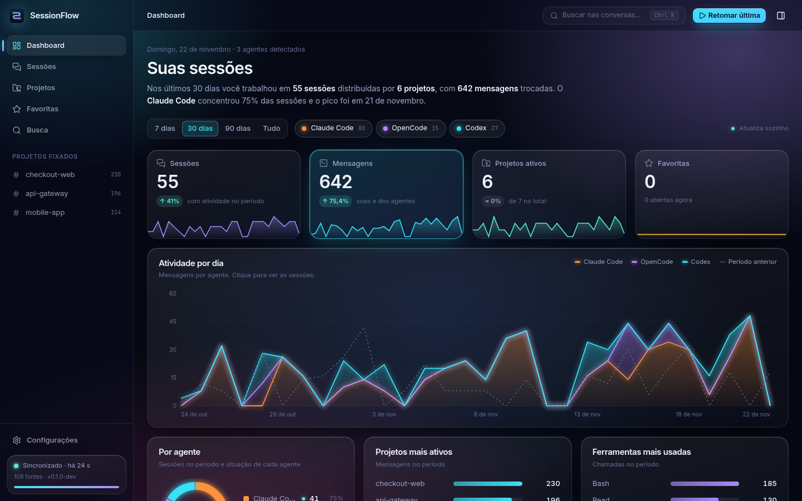

# SessionFlow

**Ideia** — Aplicativo desktop que reúne num só lugar as sessões locais de agentes de programação (Claude Code, OpenAI Codex e OpenCode). Nele dá para descobrir, organizar, pesquisar, visualizar e retomar essas sessões.

**Problema** — Cada agente guarda o histórico num formato e num diretório próprios. Achar "aquela conversa sobre X" exige lembrar em qual agente e em qual projeto ela aconteceu, e retomar exige copiar IDs para o terminal.

**Status** — `em-andamento`. Versão **0.1.0** publicada em [Releases](https://github.com/chmenegatti/sessionflow/releases): fases 0 a 9 concluídas (Discovery, Foundation, Provider Integration, Session Management, Session Viewer, Global Search, Resume & Watcher, Release, Analytics de consumo, custos estimados e padrões de atividade).

**Notas** — 100% local e offline, sem telemetria. Os históricos originais nunca são modificados. As regras do projeto estão em [CLAUDE.md](CLAUDE.md). Licença [MIT](LICENSE).



## O que faz

- **Dashboard analítico**: resumo do período, sessões e mensagens com variação, atividade por agente, projetos e ferramentas mais usados, sessões abertas e recentes.
- **Sessões e projetos**: lista unificada dos três agentes, filtros, agrupamento por projeto, favoritos e tags.
- **Viewer**: Markdown, código com destaque, chamadas de ferramenta recolhíveis. Abre históricos de centenas de MB.
- **Busca global** (`Ctrl+K`): palavras e frases em todas as conversas, com trecho destacado e salto direto para a mensagem.
- **Retomar** (`Ctrl+Enter`): abre a sessão na CLI original (`claude --resume`, `codex resume`, `opencode --session`) num terminal.
- **Sincronização automática**: sessões novas e alteradas aparecem sozinhas.

## Instalação

AppImage, `.deb`, `.rpm` e `.tar.gz` para Linux x86_64. O passo a passo, os requisitos de cada formato e as distros validadas estão em **[docs/INSTALL.md](docs/INSTALL.md)**. Resumo:

```bash
sudo apt install ./sessionflow_0.1.0_amd64.deb          # Ubuntu 24.04+, Debian 13+
sudo dnf install ./sessionflow-0.1.0-1.x86_64.rpm       # Fedora
chmod +x SessionFlow-0.1.0-x86_64.AppImage && ./SessionFlow-0.1.0-x86_64.AppImage
sessionflow --check                                      # diagnóstico sem abrir a janela
```

Mudanças por versão: [CHANGELOG.md](CHANGELOG.md).

## Stack

Go 1.26 · Wails v3.1 (GTK4 + WebKitGTK 6.0) · SQLite com FTS5 (`modernc.org/sqlite`) · slog · React 19 · TypeScript · Vite 8 · Tailwind v4 · shadcn/ui · Zustand · React Router.

## Desenvolvimento

### Pré-requisitos (Linux, Ubuntu/Debian)

```bash
sudo apt install build-essential libgtk-4-dev libwebkitgtk-6.0-dev
go install github.com/wailsapp/wails/v3/cmd/wails3@v3.1.0
wails3 doctor
```

- Go ≥ 1.26. O `go.mod` fixa `toolchain go1.26.11`, que o Go baixa sozinho (`GOTOOLCHAIN=auto`).
- Node ≥ 20 com npm.

### Comandos

`make help` lista tudo. Principais:

| Ação | Comando |
|---|---|
| Instalar dependências do frontend | `make deps` |
| Modo dev (hot reload) | `make dev` |
| Build de produção → `bin/sessionflow` | `make build` |
| Buildar e executar | `make run` |
| Testes do backend | `make test` · `make test-race` · `make cover` |
| Checagem completa (vet, staticcheck, testes com `-race`, typecheck) | `make check` |
| Vulnerabilidades | `make vuln` |
| Regenerar bindings TS | `make bindings` |
| UI no navegador (só teste) | `make server` → `http://localhost:18745` |
| Limpar builds | `make clean` |
| Pacotes de release (contêiner Ubuntu 24.04) → `dist/` | `make release` |
| Testar instalação em contêineres limpos | `make test-install` |

Capturas de tela (README, site) usam dados sintéticos, nunca conversas reais: `packaging/scripts/demo-home.py DIR` cria um `HOME` com históricos dos três agentes datados a partir de hoje; rode o app com `HOME=DIR` (e `XDG_*_HOME` dentro dele).

> O modo servidor (`make server`) expõe os serviços (leitura dos históricos, favoritos, tags) em HTTP no `localhost`. O Wails recusa `Host` e `Origin` estranhos (sites externos não chamam os bindings), mas qualquer processo local pode. Use só para testes, nunca com `WAILS_SERVER_HOST` fora do loopback.

## Arquivos locais

| O quê | Onde | Reconstruível? |
|---|---|---|
| Configuração | `$XDG_CONFIG_HOME/sessionflow/config.json` | sim (padrão) |
| Índice (sessões, busca) | `$XDG_DATA_HOME/sessionflow/index.db` | **sim**: pode ser apagado |
| Favoritos e tags | `$XDG_DATA_HOME/sessionflow/user.db` | **não** |
| Log (JSON) | `$XDG_STATE_HOME/sessionflow/sessionflow.log` | — |
| Cópias temporárias de bancos de terceiros | `$XDG_CACHE_HOME/sessionflow/snapshots/` | apagadas após a leitura |
| Lock de instância única | `$XDG_DATA_HOME/sessionflow/sessionflow.lock` | — |

## Documentação

- [docs/INSTALL.md](docs/INSTALL.md): instalação, formatos, validação e publicação
- [docs/ARCHITECTURE.md](docs/ARCHITECTURE.md): módulos, fluxo e decisões
- [docs/DOMAIN.md](docs/DOMAIN.md): modelo de domínio e esquema
- [docs/PROVIDERS.md](docs/PROVIDERS.md): formatos de cada agente
- [docs/PRODUCT.md](docs/PRODUCT.md) · [docs/MVP.md](docs/MVP.md) · [docs/ROADMAP.md](docs/ROADMAP.md)
- [docs/adr/](docs/adr/): decisões de arquitetura
- [docs/discovery/](docs/discovery/00-relatorio.md): relatório da Fase 0
- [AGENTS.md](AGENTS.md): instruções para agentes de código
